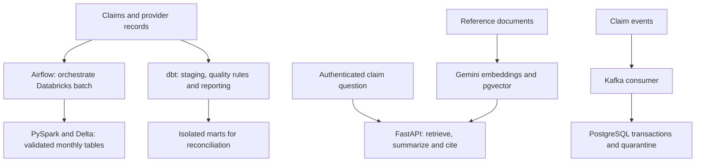

# Healthcare Claims Data Platform

This project turns healthcare claims into validated analytical tables and a monthly payment report by provider specialty. I built the reporting pipeline, data-quality controls and supporting API to make the results traceable from raw records to published totals.

The platform combines **batch processing**, **SQL transformations**, an **authenticated document-grounded API**, and a separate **Kafka ingestion pilot**. The cloud workflow uses **AWS S3 for data storage**, **Snowflake for SQL queries**, and **Azure App Service for API hosting**. It uses synthetic claims and reference documents for reproducible development and testing.

**Python · SQL · Databricks / PySpark · Delta Lake · AWS S3 · Snowflake · dbt · Airflow · FastAPI · PostgreSQL / pgvector · Gemini · Kafka · Azure App Service · Terraform**

[](https://github.com/gusbakers/max1102-pipeline/actions/workflows/ci.yml)

## Engineering results

| Area | Verified result or implemented scope |
|---|---|
| Reproducible source data | Generator produces **50,100 claims and 1,200 providers**, including deliberate data-quality defects. |
| SQL transformation layer | **8 dbt models and 16 data tests** for staging, validation, reconciliation and reporting. |
| Known-answer validation | Local dbt benchmark reconciles **69 input rows = 1 exact duplicate + 8 rejects + 60 valid claims**, producing four report rows. |
| API and RAG | **51 tests passed in the recorded local suite**, with provider calls mocked or intercepted. |
| Automated integration | [Completed CI run](https://github.com/gusbakers/max1102-pipeline/actions/runs/39306847180) checks the API, Airflow DAG, dbt, Kafka/PostgreSQL integration, operational tooling and Terraform configuration. |

The larger generated dataset and the small dbt verification fixture are separate inputs. These results measure implementation and test behavior; they do not establish production throughput, cost savings or live Gemini answer quality. See the [validation record](docs/VALIDATION.md) for evidence and scope.

## Architecture



The dbt models are validated separately before replacing the notebook transformations. The streaming pilot lands events in PostgreSQL; a continuous Kafka-to-Delta integration is outside the implemented scope.

## Cloud storage, SQL analytics and API hosting

| Service | Role in the project |
|---|---|
| **AWS S3** | Stores exported **Bronze, Silver and Gold snapshots** from Databricks, including claims, providers, monthly reports and engineered features. |
| **Snowflake** | Provides **SQL queries over the S3 snapshot through an external stage**, separating analytical queries from Databricks processing. |
| **Azure App Service** | Hosts the **authenticated FastAPI service** independently of Codespaces, with a `/health` endpoint and GitHub Actions deployment tooling. |

## What the project solves

**Reliable monthly reporting.** The batch DAG prepares a run, extracts Parquet inputs, validates records, transforms accepted claims, publishes the report and records completion. The report contains `specialty`, `claim_count`, `total_amount` and `report_month`. Only `PAID` claims contribute to its totals. Reloading a selected month preserves other months.

**Traceable data quality.** Invalid records are quarantined with rejection reasons. SQL tests check identifiers, required fields, provider relationships, report grain and financial reconciliation. Known-answer checks verify repeatability and confirm that conflicting providers or excessive rejection stop publication.

**Answers grounded in reference documents.** The FastAPI service offers claim summaries and a RAG endpoint using Gemini embeddings, pgvector retrieval and citation checks. API-key authentication protects claim endpoints; `/health` reports process health without calling the model.

**Recoverable event ingestion.** The Kafka pilot uses transactional writes, duplicate control and quarantine for invalid events. Integration checks exercise broker acknowledgements and consumer recovery against actual Kafka and PostgreSQL services.

## Evaluation and monitoring

CI tests the API, DAG dependencies and retry configuration, dbt outputs, integration services and deployment tooling. Build artifacts identify their source commit. The Azure deployment workflow uses OIDC and checks application health plus the deployed SHA when enabled.

Operational tooling records request metadata without claim bodies or identifiers, probes service health, and manages deduplicated incidents and recovery. Terraform definitions and cost-review tooling support deployment operations. The [validation record](docs/VALIDATION.md) distinguishes completed checks from cloud activation requirements.

## Run and inspect

Start with GitHub Codespaces or a terminal at the repository root. Generate the synthetic input files:

```bash
python data/generate_data.py
```

This writes `data/claims.csv` and `data/providers.csv`. The [operations guide](docs/OPERATIONS.md) explains Parquet preparation, Databricks jobs, Airflow configuration and report parameters.

After configuring `.env` and the Databricks connection:

```bash
docker build -t max1102-airflow:3.2.0 airflow
docker compose up airflow-init
docker compose up -d
```

Open port 8080 from Codespaces. The monthly DAG is manually triggered and permits one active run. Stop the local environment with `docker compose down` after the run finishes.

**Deployment status:** the original notebook path requires reviewed workspace exports because `00_common.py` is missing helpers used by its tasks. Cloud execution of the dbt replacement, authenticated live RAG evaluation and full deployment verification remain separate activation steps. A passing test suite does not imply that these services are running in a cloud account.

## Repository guide

| Path | Purpose |
|---|---|
| `airflow/` | Container configuration and orchestration DAGs |
| `databricks/` | Batch notebooks and transformation comparison assets |
| `dbt/` | SQL models, fixtures, quality tests and profiles |
| `api/`, `knowledge/` | Authenticated summary/RAG API and reference documents |
| `streaming/` | Kafka producer, event contracts and transactional consumer |
| `infra/`, `ops/` | Terraform definitions and deployment operations |
| `.github/workflows/` | CI, conditional deployment and monitoring |
| `docs/VALIDATION.md`, `docs/OPERATIONS.md` | Evidence, deployment scope and operating instructions |

**Gustavo** · Master's in Data Science · [GitHub](https://github.com/gusbakers)
