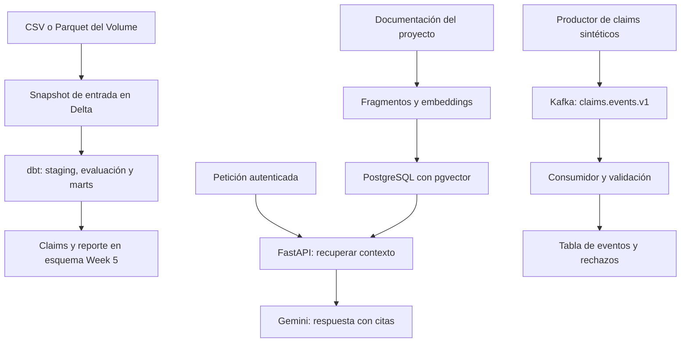

# Semana 5 — dbt, búsqueda semántica, RAG y Kafka

La semana incorpora tres capacidades al proyecto: transformaciones SQL administradas por dbt, explicaciones de claims con recuperación de documentos y un piloto independiente de eventos con Kafka. El código está dividido por día. **Implementación, pruebas de laboratorio y activación en tus cuentas son estados distintos**; consulta [estado y evidencia](status.md).

## Mapa del trabajo

| Día | Trabajo | Stack | Archivos principales |
| --- | --- | --- | --- |
| [Lunes](lunes.md) | Migración SQL y comparación | dbt Core, Databricks, Delta; DuckDB para pruebas | `dbt/`, `databricks/week5/` |
| [Martes](martes.md) | Corpus, embeddings y búsqueda | Gemini Embeddings, PostgreSQL, pgvector | `knowledge/`, `week5/ingest_knowledge.py`, `api/rag_store.py` |
| [Miércoles](miercoles.md) | API con recuperación y citas | FastAPI, Gemini | `api/rag.py`, `api/main.py`, `api/test_rag.py` |
| [Jueves](jueves.md) | Ingesta de eventos | Kafka KRaft, Python, PostgreSQL | `streaming/`, `compose.week5.yml` |
| [Viernes](viernes.md) | Integración, evidencias y demo | GitHub Actions, Airflow y pruebas | `.github/workflows/ci.yml`, `week5/tests/`, `airflow/dags/max_week5_claims_dbt.py` |



Estos son tres flujos implementados por separado. dbt prepara las tablas; el corpus inicial del RAG contiene documentación versionada, no una exportación de todas las filas de dbt. Kafka escribe una tabla de recepción en PostgreSQL; todavía no hay un enlace continuo Kafka → Delta. No se necesita Kafka para responder una petición RAG.

## Preparación común en Codespaces

Abre el repositorio y ejecuta estos bloques desde su raíz. Actualiza tu copia mediante Git cuando los cambios ya estén integrados; revisa `git status` antes de cambiar de rama para conservar trabajo pendiente.

```bash
python3.12 -m venv .venv-week5
.venv-week5/bin/python -m pip install -r week5/requirements-test.txt
.venv-week5/bin/python -m week5.setup_local
```

El último comando crea `week5/.env` con credenciales **locales**, permisos de archivo restringidos y sin sobrescribir un archivo existente. Añade allí la clave de Gemini que uses para el laboratorio. Para cargar esas variables en cada terminal:

```bash
set -a
source week5/.env
set +a
```

Comprueba Docker con `docker version` y `docker compose version`. El laboratorio de Kafka y pgvector se inicia así:

```bash
docker compose --env-file week5/.env -f compose.week5.yml up -d --wait --wait-timeout 180
```

PostgreSQL escucha en `127.0.0.1:5433` y Kafka en `127.0.0.1:9092`. Esta base está separada de los metadatos de Airflow. Las credenciales generadas son para este laboratorio, no son las de Azure ni Databricks. Codespaces, los runners de Actions y Azure tienen configuraciones independientes.

Los paquetes de código abierto no exigen contratar un servicio administrado de Kafka. El cómputo de Codespaces, Databricks y las llamadas a Gemini sí dependen de las cuotas y condiciones de tus cuentas. La configuración no crea una cuenta de pago ni un clúster administrado.

## Criterio para cerrar la semana

1. dbt genera los resultados esperados y rechaza datos que incumplen sus límites de calidad.
2. La ejecución en Databricks usa el snapshot correcto y la comparación con la versión operativa no muestra diferencias sin explicar.
3. El RAG recupera documentos reales de la colección y devuelve citas verificables; una consulta sin evidencia suficiente se reconoce como tal.
4. Kafka entrega eventos al destino y la repetición no duplica los eventos guardados.
5. Las ejecuciones verificadas y las tareas de activación pendientes se registran sin presentar unas como otras.

## Referencias oficiales

- [Adaptador dbt para Databricks](https://github.com/databricks/dbt-databricks)
- [Tareas dbt en Databricks](https://docs.databricks.com/aws/en/jobs/tasks/dbt)
- [Embeddings de Gemini](https://ai.google.dev/gemini-api/docs/embeddings)
- [Disponibilidad y retiro de modelos](https://ai.google.dev/gemini-api/docs/deprecations)
- [pgvector](https://github.com/pgvector/pgvector)
- [Inicio rápido de Kafka](https://kafka.apache.org/quickstart/)
